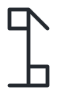
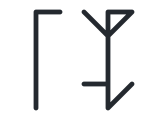
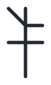
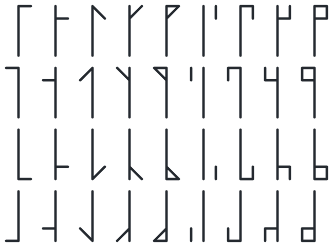

# cistercian

Render any number as [Cistercian numerals](https://en.wikipedia.org/wiki/Cistercian_numerals): SVG with zero dependencies, plus PNG, JPEG and WebP through [sharp](https://sharp.pixelplumbing.com/).

<p>
  
  
  
  
</p>

Cistercian monks wrote any number from 1 to 9999 as a single glyph: a vertical stem with one digit in each corner. Units go top right, tens top left, hundreds bottom right and thousands bottom left.



## Install

```sh
npm install cistercian
npm install sharp   # only needed for PNG, JPEG and WebP
```

## Usage

```js
import { toSvg } from 'cistercian';

const svg = toSvg(1993);
const red = toSvg(1993, { size: 200, color: '#c00', background: 'white' });
```

```js
import { toImage } from 'cistercian/raster';
import { writeFile } from 'node:fs/promises';

await writeFile('1993.webp', await toImage(1993, { format: 'webp', size: 400 }));
```

### Command line

```sh
npx cistercian 1993 > 1993.svg
npx cistercian 3.14159 -o pi.webp --size 200
npx cistercian -42 -o minus.png
```

Run `npx cistercian --help` for every option.

## Numbers beyond 1–9999

The historical system stops at 9999. This library extends it so every decimal number gets a drawing:

| Input    | Drawn as          | Rule                                                              |
| -------- | ----------------- | ----------------------------------------------------------------- |
| `0`      | a bare stem       | No digits, so no strokes.                                         |
| `12345`  | `1` `2345`        | One glyph per four digits, like base 10000.                       |
| `10000`  | `1` `0`           | Empty groups are bare stems, so the position is never lost.       |
| `12.5`   | `12` **·** `5000` | A dot on the baseline, then the fraction in groups of four.       |
| `0.0005` | `0` **·** `5`     | Fraction groups count from the point, so `.5` and `.0005` differ. |
| `-42`    | `42` with a bar   | A horizontal bar across the middle of the first stem.             |

Zero as a bare stem and the negative bar follow [akosnikhazy/cistercian-numerals](https://github.com/akosnikhazy/cistercian-numerals), which this library also follows for its proportions. These extensions are modern; the monks didn't use them.

### Floats

Inputs can be a `number`, a `bigint` or a decimal `string`. A number is first written in its shortest exact form, so `0.1` draws as `0.1`. Arithmetic results can carry float noise, and that gets drawn too: `0.1 + 0.2` is `0.30000000000000004`. Round first when that matters:

```js
toSvg((0.1 + 0.2).toFixed(2)); // 0.30
toSvg('123456789012345678901234567890'); // strings and bigints keep every digit
```

## API

### `toSvg(value, options?)` → `string`

| Option        | Default        | Notes                                                                 |
| ------------- | -------------- | --------------------------------------------------------------------- |
| `size`        | `100`          | Image height in pixels. The width follows from the number of glyphs.  |
| `color`       | `currentColor` | Stroke colour. `currentColor` picks up the surrounding text colour.   |
| `background`  | none           | Fill behind the glyphs.                                               |
| `strokeWidth` | `4`            | In viewBox units, where the stem is 80 long and each corner is 20×20. |
| `linecap`     | `round`        | `round`, `square` or `butt`.                                          |
| `gap`         | `20`           | Space between glyphs, in viewBox units.                               |
| `padding`     | `10`           | Space around the glyphs, in viewBox units.                            |
| `title`       | the number     | Accessible name. `false` leaves it out and sets `aria-hidden`.        |

### `toImage(value, options?)` → `Promise<Buffer>` from `cistercian/raster`

Takes every `toSvg` option, plus `format` (`png`, `jpeg`, `jpg` or `webp`; default `png`) and `quality` (1–100). Strokes default to black. JPEG gets a white background unless you pass one.

### Lower level

- `parse(value)` → `{ negative, integer, fraction }`: the base-10000 groups that become glyphs.
- `format(parsed)` → the canonical decimal string, e.g. `-12.5`.
- `glyphStrokes(n, { negative? })` → polylines for one glyph from 0 to 9999, in units where the stem runs from `(0, 0)` to `(0, 4)`. Use these to draw on a canvas or in another format.

## Development

```sh
yarn install
yarn test
yarn examples   # regenerate examples/
```

## License

MIT
